# Les Dimensions Oubliées (`forgotten_dimensions`)

Mod RPG pour **Minecraft Java 1.21.11** (Fabric). Il ajoute la civilisation disparue des Anciens
Architectes, ses fragments, sa technologie, la magie, une progression RPG complète, des armes et
armures par centaines, et prépare les sept dimensions oubliées.

> **État du projet : phases 1 à 5 terminées sur 10.** Les sept dimensions sont explorables et
> peuplées de 60 créatures. Les 14 boss, les structures, les quêtes, les PNJ et les musiques
> originales ne sont **pas encore** présents. La section
> [Avancement](#avancement-par-phase) détaille ce qui est fait et ce qui reste à faire.

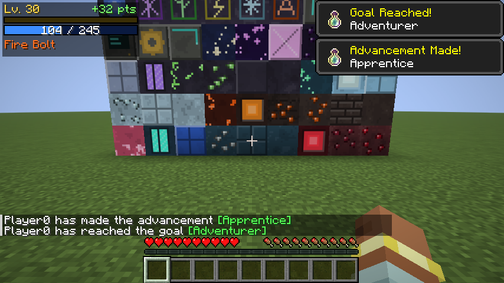

| Arbre de compétences | Livre de magie |
|---|---|
| 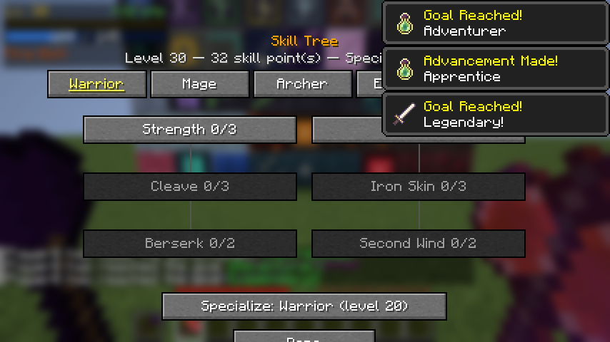 | 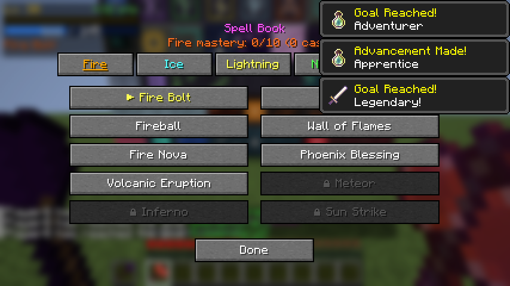 |
| **Armure de la Reine du Givre et Marteau Volcanique** | **Inventaire : armes, arc, arbalète, couronne** |
| 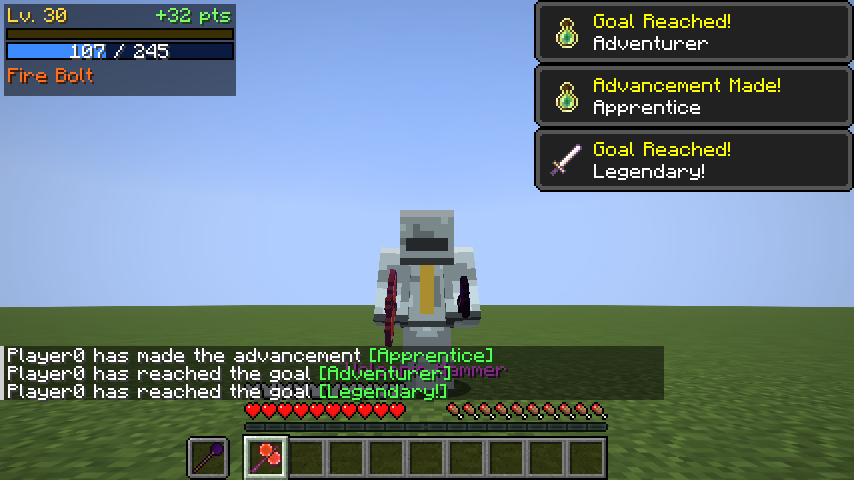 | 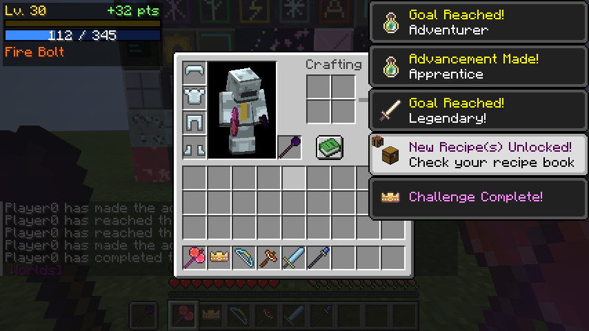 |

| Royaume Céleste | Dimension Corrompue | Océan Oublié |
|---|---|---|
| 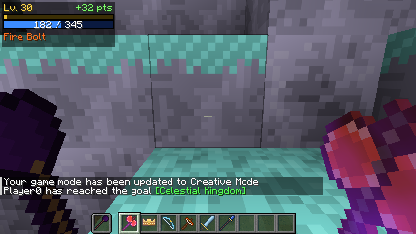 | 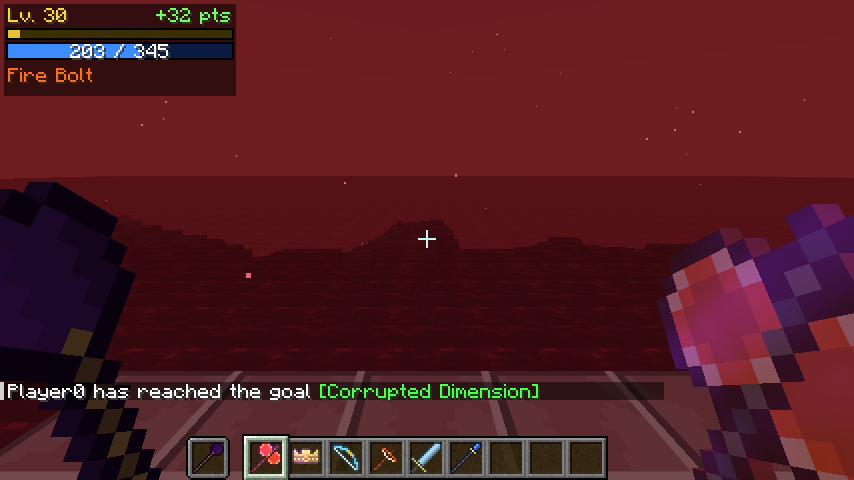 | 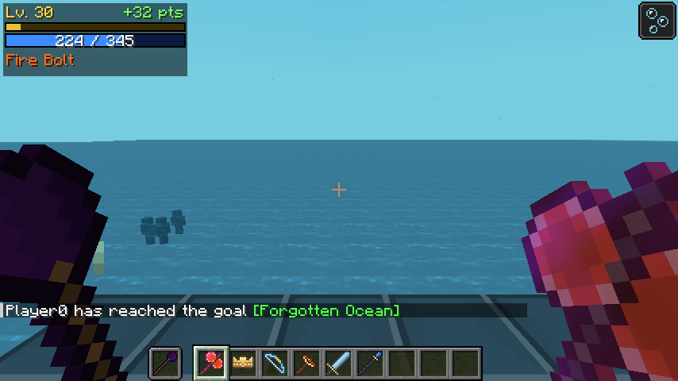 |
| **Terres du Chaos** | **Monde Éternel** | **Les Profondeurs** |
| 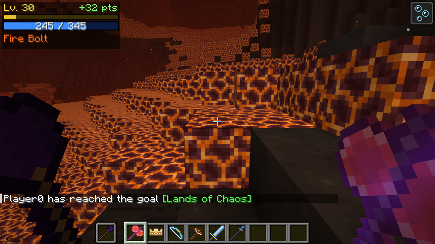 | 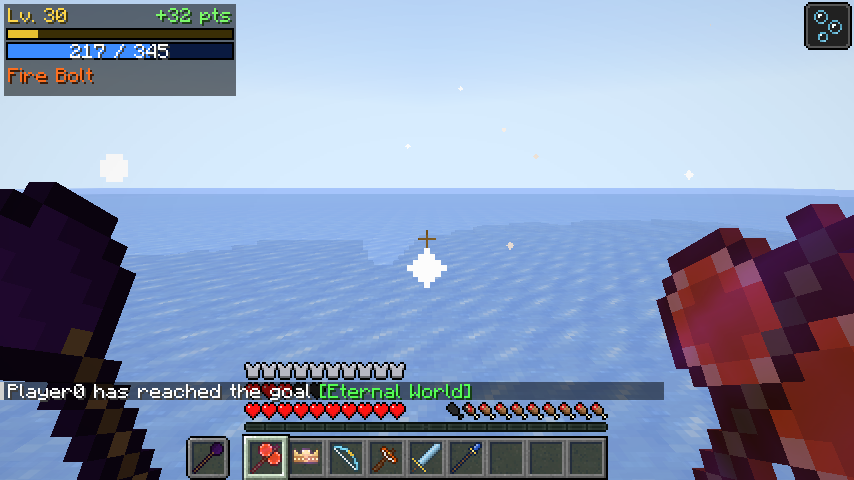 | 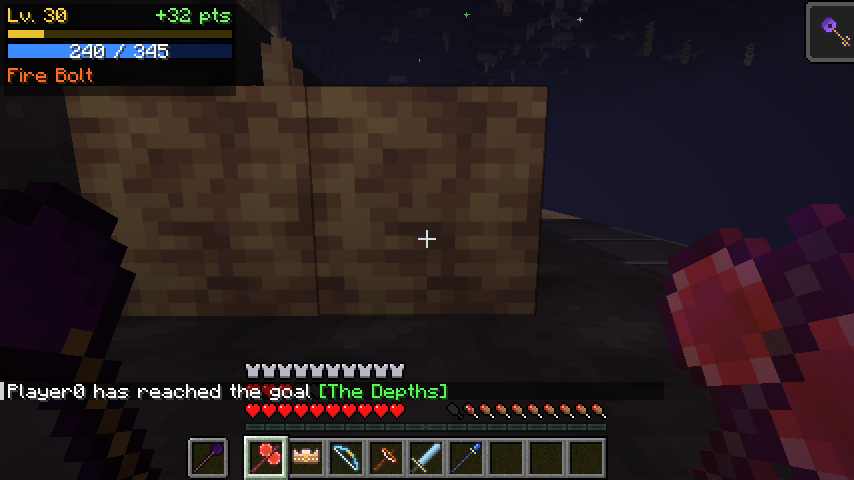 |
| **Le Néant** | **Créatures (1)** | **Créatures (2)** |
| 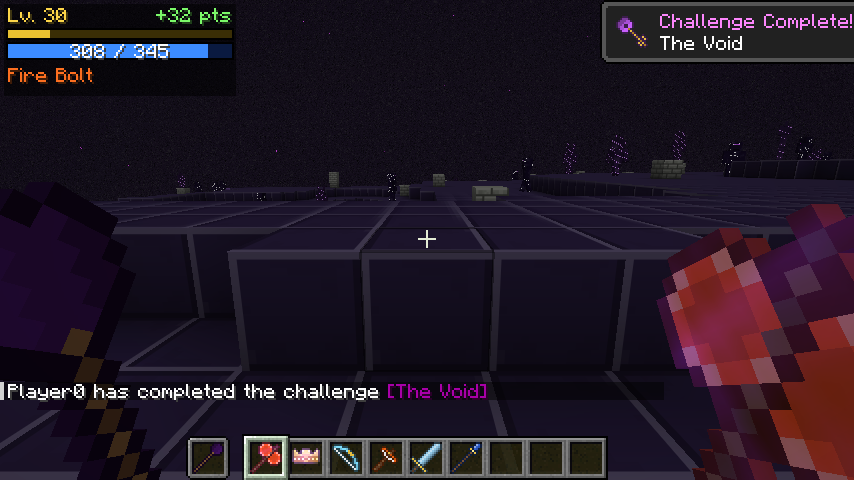 | 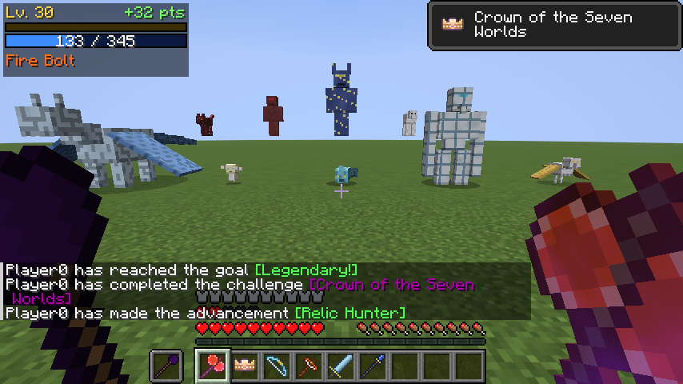 | 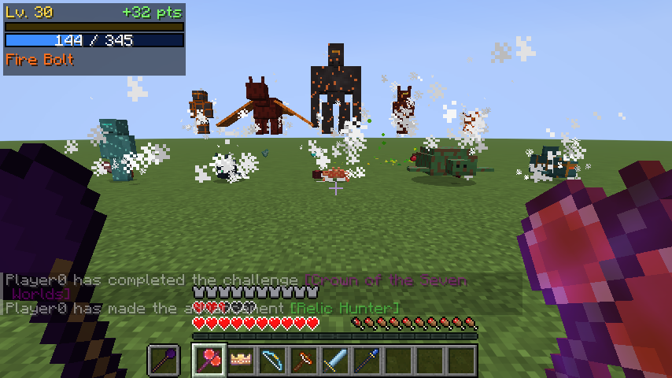 |
| **Créatures (3)** | **Créatures (4)** | **Créatures (5)** |
| 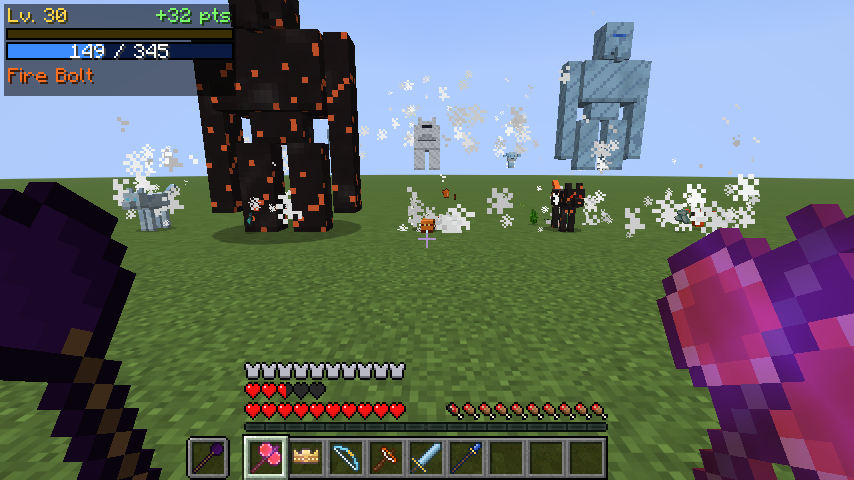 | 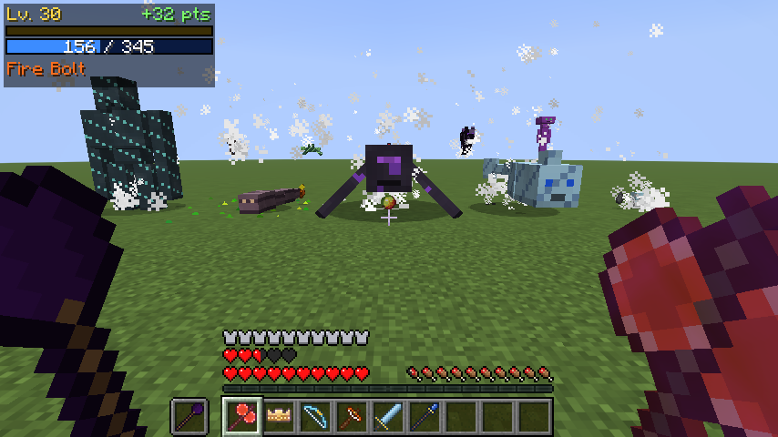 | 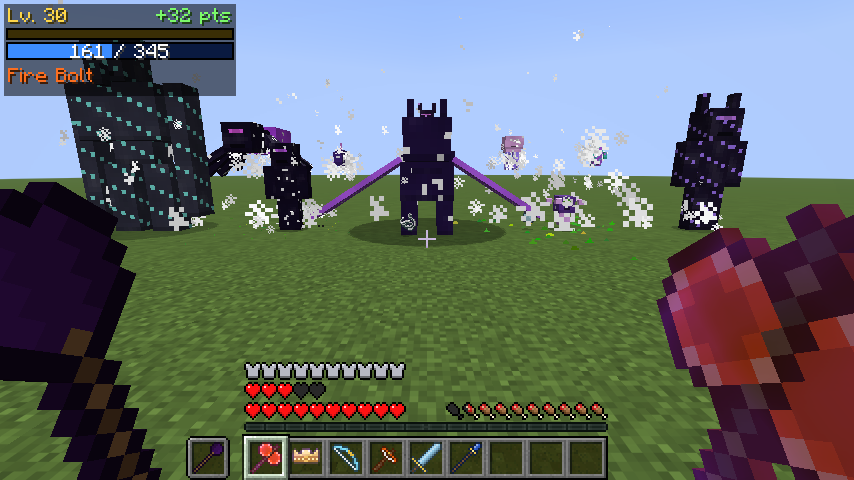 |

Captures prises automatiquement par le test client (`FdClientGameTest`) dans un vrai Minecraft
1.21.11 (rendu logiciel, sans carte graphique).

> 📖 **Manuel du joueur illustré** : [`docs/manuel/Manuel - Les Dimensions Oubliees.pdf`](docs/manuel/)
> (aussi en HTML : `docs/manuel/manuel.html`). Il est généré à partir des données du mod par
> `python3 tools/manual/build_manual.py` puis `node tools/manual/export_pdf.cjs`.

---

## Sommaire

1. [Prérequis](#prérequis)
2. [Installer Java 21](#installer-java-21)
3. [Installer Fabric (pour jouer)](#installer-fabric-pour-jouer)
4. [Ouvrir le projet](#ouvrir-le-projet)
5. [Compiler](#compiler)
6. [Lancer le jeu en développement](#lancer-le-jeu-en-développement)
7. [Installer le mod](#installer-le-mod)
8. [Créer un serveur](#créer-un-serveur)
9. [Commandes](#commandes)
10. [Contenu du mod](#contenu-du-mod)
11. [Configuration](#configuration)
12. [Tests](#tests)
13. [Architecture du code](#architecture-du-code)
14. [Générateur de contenu](#générateur-de-contenu)
15. [Problèmes fréquents](#problèmes-fréquents)
16. [Avancement par phase](#avancement-par-phase)

---

## Prérequis

| Outil | Version | Remarque |
|---|---|---|
| Java (JDK) | **21** | Obligatoire pour Minecraft 1.21.11 |
| Minecraft Java Edition | **1.21.11** | |
| Fabric Loader | **0.20.1** (ou plus récent) | |
| Fabric API | **0.141.6+1.21.11** | À placer dans `mods/` avec le mod |
| Gradle | 9.2.1 | Fourni par le Gradle Wrapper (`./gradlew`), rien à installer |
| Python 3 + Pillow | facultatif | Uniquement pour régénérer le contenu (`tools/gen`) |

Versions de compilation (fichier `gradle.properties`) : Fabric Loom 1.14.10, Yarn
`1.21.11+build.6`, Fabric Loader 0.20.1, Fabric API 0.141.6+1.21.11. Toutes ont été vérifiées sur
`maven.fabricmc.net`.

## Installer Java 21

- **Windows / macOS** : installer le JDK 21 d'[Adoptium Temurin](https://adoptium.net/) (cocher
  « Set JAVA_HOME » sous Windows).
- **Linux (Debian/Ubuntu)** : `sudo apt install openjdk-21-jdk`
- Vérifier : `java -version` doit afficher `21`.

## Installer Fabric (pour jouer)

1. Télécharger l'installateur sur <https://fabricmc.net/use/installer/>.
2. Choisir **Minecraft 1.21.11** et le loader **0.20.1** ou plus récent, puis « Installer ».
3. Un profil « fabric-loader-1.21.11 » apparaît dans le launcher Minecraft.

## Ouvrir le projet

- **IntelliJ IDEA** (recommandé) : *File → Open…* puis sélectionner le dossier du projet. IntelliJ
  importe Gradle automatiquement ; Loom crée les configurations « Minecraft Client » et
  « Minecraft Server ».
- **VS Code** : installer « Extension Pack for Java », ouvrir le dossier, puis lancer
  `./gradlew vscode`.
- **Eclipse** : `./gradlew eclipse`, puis importer le projet existant.

Le premier import télécharge Minecraft et les dépendances (plusieurs centaines de Mo).

## Compiler

```bash
./gradlew build          # compile, lance les tests JUnit + GameTests serveur, produit le JAR
./gradlew build -x test  # compile seulement
```

Sous Windows, utiliser `gradlew.bat` à la place de `./gradlew`.

Le mod compilé se trouve dans `build/libs/forgotten_dimensions-0.1.0.jar`.

## Lancer le jeu en développement

```bash
./gradlew runClient   # lance Minecraft avec le mod
./gradlew runServer   # lance un serveur dédié de développement (dossier run/)
```

## Installer le mod

1. Installer Fabric (voir plus haut).
2. Copier dans le dossier `mods` de Minecraft :
   - `forgotten_dimensions-0.1.0.jar`
   - `fabric-api-0.141.6+1.21.11.jar` (depuis Modrinth ou CurseForge)
3. Emplacement du dossier `mods` :
   - Windows : `%appdata%\.minecraft\mods`
   - macOS : `~/Library/Application Support/minecraft/mods`
   - Linux : `~/.minecraft/mods`
4. Lancer le profil Fabric 1.21.11.

## Créer un serveur

1. Télécharger l'installateur serveur Fabric : <https://fabricmc.net/use/server/> (Minecraft 1.21.11).
2. Lancer le JAR téléchargé une première fois : `java -Xmx4G -jar fabric-server-launch.jar nogui`.
3. Accepter le contrat : passer `eula=false` à `eula=true` dans `eula.txt`.
4. Copier le mod **et** Fabric API dans `mods/` du serveur.
5. Relancer. Les joueurs doivent avoir le même mod et la même Fabric API.
6. Donner les droits d'administration pour les commandes : `op <pseudo>` dans la console.

Le serveur fait autorité : sorts, compétences, mana, expérience et recharges sont validés côté
serveur ; le client ne fait qu'envoyer des demandes. Les données de progression sont enregistrées
avec chaque joueur (Fabric Data Attachment API) et synchronisées uniquement vers lui.

## Commandes

Toutes les commandes exigent le niveau de permission « maître du jeu » (opérateur, niveau 2).

| Commande | Effet |
|---|---|
| `/fdimension list` | Liste les sept dimensions et indique si elles sont générées |
| `/fdimension tp <dimension>` | Voyage dans une dimension (même arrivée sûre et portail de retour que par le portail) |
| `/fdimension home` | Retour au point de départ mémorisé (ou au point d'apparition) |
| `/fdimension give <objet> [nombre]` | Donne un objet ou bloc du mod (auto-complétion) |
| `/fdimension level set <joueur> <niveau>` | Fixe le niveau RPG (1 à 100) |
| `/fdimension level get <joueur>` | Affiche niveau, expérience et points |
| `/fdimension xp add <joueur> <quantité>` | Ajoute de l'expérience RPG |
| `/fdimension skills reset <joueur>` | Rembourse tous les points de compétence et retire la spécialisation |
| `/fdimension reload` | Recharge `config/forgotten_dimensions.json` |

`/fdimension boss spawn <boss>` sera ajoutée avec les boss (phase 6) : elle n'est pas enregistrée
tant qu'il n'existe aucun boss à invoquer.

### Raccourcis clavier (modifiables dans Options → Commandes)

| Touche | Action |
|---|---|
| **Clic droit** avec un bâton ou une baguette | Lancer le sort actif |
| `G` | Changer de sort (sort débloqué suivant du grimoire actif) |
| `V` | Basculer entre sorts d'attaque et sorts d'invocation |
| `K` | Arbre de compétences |
| `B` | Livre de magie |

## Les sept dimensions

| Dimension | Terrain | Biomes |
|---|---|---|
| **Royaume Céleste** | îles flottantes au-dessus du vide, nuages bas | Prairie céleste, Forêt des nuages, Montagnes flottantes, Jardin des étoiles, Ruines suspendues |
| **Dimension Corrompue** | continents, mers rouges, ciel écarlate | Forêt écarlate, Marais corrompu, Plaine des racines, Montagnes infectées, Désert de cendres rouges |
| **Océan Oublié** | monde presque entièrement englouti (niveau de la mer à 150) | Récif lumineux, Abysses, Forêt de corail, Plaine engloutie, Tranchée obscure |
| **Terres du Chaos** | monde volcanique à plafond, océan de lave | Océan de lave, Forêt de braises, Montagnes volcaniques, Désert de magma, Citadelle du chaos |
| **Monde Éternel** | terres et mers gelées, neige permanente | Forêt givrée, Glacier éternel, Montagnes blanches, Lac gelé, Royaume de glace |
| **Les Profondeurs** | immense réseau de cavernes à plafond | Cavernes cristallines, Forêt fongique, Abysses souterrains, Ruines enfouies, Royaume des ombres |
| **Le Néant** | îles dans le vide cosmique | Désert du vide, Îles stellaires, Océan astral, Ruines dimensionnelles, Royaume du néant |

Chaque dimension a son type (lumière, ciel, brouillard, nuages, plafond, lit), ses réglages de
terrain, sa règle de surface (blocs de sol propres à chaque biome), ses 3 minerais en deux
variantes, des poches de pierre profonde, des grottes, et des décorations : arbres de **bois des
nuages**, de **racine pourpre** et de **pin de givre**, **géodes géantes** de cristaux (céleste,
luminite, givre, néant), herbes et fleurs, coraux, colonnes de basalte, pics de glace, champignons
géants, dripstone, plantes de chorus, particules d'ambiance (cendres, spores, neige, portail…).
La génération est entièrement déterministe selon la graine du monde.

### Voyager : portails et clés

1. Fabriquer un **Portail dimensionnel** (pierre d'Architecte, obsidienne pleureuse, noyau
   d'Architecte) et le poser.
2. Fabriquer la **clé** d'une dimension : 8 fragments de cette dimension (minerais de fragments de
   la Surface) autour d'un noyau d'Architecte.
3. Clic droit sur le portail avec la clé : voyage (la clé n'est pas consommée). À l'arrivée, un
   point sûr est cherché (sol solide, deux blocs libres, ni eau ni lave). Sinon une plateforme est
   construite, à la surface de l'eau dans l'Océan. Un **portail de retour** est placé à côté.
4. Clic droit à main vide sur un portail dans une dimension : retour au point de départ.

La **clé du Néant** exige les six **cœurs des gardiens** (lâchés par les boss de la phase 6) : le
Néant n'est donc accessible en survie qu'après les six gardiens, comme prévu par le scénario (en
attendant, `/fdimension give` ou `/fdimension tp void`). Tomber sous le monde dans le Royaume
Céleste ou le Néant ramène au point de départ au lieu de tuer. L'arrivée affiche un titre
(« Chapitre III — Les dimensions », « Chapitre VII » pour le Néant). Un succès est débloqué par
dimension visitée.

## Les 60 créatures

| Dimension | Créatures |
|---|---|
| **Royaume Céleste** | Aigle céleste (neutre), Gardien des nuages (hostile), Serpent aérien (hostile), Esprit lumineux (passive), Dragon des cieux (**élite**), Sylphe du vent (passive), Bélier des nuages (passive), Héraut de la tempête (***mini-boss***) |
| **Dimension Corrompue** | Zombie corrompu (hostile), Loup mutant (hostile), Araignée écarlate (hostile), Golem infecté (**élite**), Entité végétale (hostile), Rampant corrompu (hostile), Sanglier corrompu (neutre), Spectre putride (hostile), Chevalier corrompu (***mini-boss***) |
| **Océan Oublié** | Léviathan (**élite**), Requin spectral (hostile), Méduse lumineuse (passive), Gardien abyssal (hostile), Tortue ancienne (passive), Crabe du récif (passive), Baudroie des abysses (hostile), Architecte noyé (hostile) |
| **Terres du Chaos** | Salamandre de feu (hostile), Démon de magma (hostile), Golem volcanique (**élite**), Dragon de lave (**élite**), Chevalier des braises (hostile), Diablotin de cendre (hostile), Molosse de cendre (hostile), Limace de lave (passive), Colosse infernal (***mini-boss***) |
| **Monde Éternel** | Loup fantôme (hostile), Géant de glace (**élite**), Esprit hivernal (hostile), Ours ancien (neutre), Chevalier du gel (hostile), Lièvre des neiges (passive), Feu follet de givre (passive), Wyrm glaciaire (***mini-boss***) |
| **Les Profondeurs** | Araignée colossale (**élite**), Ver des profondeurs (hostile), Gardien aveugle (hostile), Champignon vivant (neutre), Ombre prédatrice (hostile), Chauve-souris lugubre (hostile), Scarabée de cristal (passive), Taupe des galeries (passive), Traqueur ombral (***mini-boss***) |
| **Le Néant** | Spectre cosmique (hostile), Dragon astral (**élite**), Entité du vide (hostile), Gardien dimensionnel (**élite**), Fragment vivant (hostile), Méduse stellaire (passive), Marcheur du néant (hostile), Raie nébuleuse (passive), Horreur de la faille (***mini-boss***) |

**Modèles et animations.** Les modèles 3D sont originaux. Ils reposent sur 19 formes (bipède,
bipède cornu, plante, golem, quadrupède, loup, ours, araignée, crabe, oiseau, dragon, serpent, ver,
poisson, requin, méduse, esprit, cristal, tortue), décrites dans `tools/gen/modelgen.py`. Chaque
créature a sa texture et sa taille. Les animations sont générées par le code : la tête suit le
regard, les jambes et les bras se balancent, les bras se lèvent à l'attaque, les ailes battent,
les queues et les segments ondulent, les tentacules flottent, les orbes tournent.

**IA et comportements** (configurés créature par créature) : patrouille autour du point
d'apparition, protection d'une zone (attaque les intrus dans un rayon de 16 blocs), poursuite et
attaque, fuite (créatures craintives, fuite à faible vie), défense quand on les attaque (neutres),
**appel de renforts** et chasse en meute, nage et vol réels.

**Capacités** (25) : projectiles des 5 écoles de magie, bond, charge, invocation de sbires
(élites et mini-boss), auras (ralentissement, poison, flétrissement, fatigue), soin, téléportation,
foudre, souffle glacé, nova de feu, racines, effets au contact (poison, flétrissement, feu, gel,
cécité), traque invisible, explosion à la mort.

**Catégories** : passives, neutres, hostiles, **élites** (plus grandes, plus résistantes,
invocations) et **mini-boss** (barre de vie à l'écran, sbires, butin d'artefacts). Chaque créature
a ses statistiques (vie, dégâts, vitesse, armure, résistance au recul), qui augmentent de dimension
en dimension, son expérience, son butin (matériaux, essences, fragments, artefacts rares) et un
**œuf d'apparition** (onglet créatif « Créatures »).

**Apparition naturelle** dans les biomes de leur dimension. Les hostiles ne craignent pas la
lumière du ciel, seulement celle des blocs (torches, lampes). La densité est limitée par espèce
(5 dans 32 blocs, 1 élite dans 48 blocs, 1 mini-boss dans 96 blocs). L'option
`creatureSpawnMultiplier` règle la fréquence d'apparition.

Les sons sont pour l'instant ceux de Minecraft, choisis par type de créature ; des sons originaux
viendront en phase 9.

## Contenu du mod

Tout le contenu ci-dessous est enregistré dans le jeu, a une texture, un modèle, une traduction
FR/EN, une recette ou un moyen d'obtention, et est vérifié par les tests.

### Blocs (282)

- **58 minerais** : 21 matériaux × 2 variantes (pierre dimensionnelle et pierre profonde),
  plus 16 minerais de la Surface (fragment ancien et 7 fragments dimensionnels, en pierre et en
  ardoise des abîmes). Ils lâchent minerai brut ou gemme, avec Fortune, Toucher de soie et
  expérience.
- **7 pierres dimensionnelles** (pierre des nuages, pierre corrompue, pierre abyssale, pierre de
  cendre, roche de givre, roche ombrale, pierre du néant), chacune avec variante profonde, briques,
  polie, sculptée, dalles, et **escaliers, dalles et murets** (84 blocs de forme).
- **28 blocs de stockage** (21 blocs de matériau + 7 blocs de minerai brut).
- **20 blocs lumineux** (lampes, lanternes, blocs stellaires, veines lumineuses).
- **15 blocs technologiques anciens** : le *Noyau énergétique* émet un signal de redstone de 15,
  le *Terminal runique* raconte un fragment de l'histoire (7 archives), circuits et conduits
  lumineux.
- **15 blocs magiques** : cristal de mana (+30 mana au clic droit, recharge 30 s), 5 pierres
  runiques (effet selon l'école quand on marche dessus), ligne tellurique (double la
  régénération de mana), source guérisseuse, pierre de protection (repousse les monstres), autel
  des sorts (affiche la maîtrise de magie), etc.

- **20 blocs de la phase 4** : 10 sols de surface (herbes et terres céleste, corrompue, givrée,
  ombrale, astrale), 3 bois (bûches, planches utilisables comme des planches vanilla, feuilles qui
  se décomposent) et le Portail dimensionnel.

Les **minerais de fragments se génèrent dans la Surface** (fragment ancien entre Y −48 et 48 ;
fragments dimensionnels, plus rares, entre Y −64 et 16), et les **42 minerais dimensionnels se
génèrent dans leur dimension**.

### Matériaux et objets (63)

21 matériaux (7 lingots avec leur minerai brut, 14 gemmes), 7 fragments dimensionnels, 7
essences dimensionnelles, fragment ancien, noyau d'Architecte, alliage primordial et 5 projectiles
de sort (objets techniques utilisés pour l'affichage des sorts), 7 clés dimensionnelles et 6 cœurs
de gardiens.

### Armes (100)

9 catégories × 10 paliers (argent astral → primordial) + 10 armes légendaires.

| Catégorie | Particularité |
|---|---|
| Épée | équilibrée |
| Grande épée | lente, dégâts de zone autour de la cible |
| Dague | rapide, 15 % de chance de coup supplémentaire |
| Hache de combat | désactive les boucliers, affaiblit la cible |
| Lance | mécanique de lance de Minecraft 1.21.11 (charge) |
| Bâton magique | clic droit : projectile de l'école du palier (10 mana) |
| Baguette | clic droit : petit projectile rapide (4 mana) |
| Arc / Arbalète | dégâts de projectile selon le palier, animations de tension |

Raretés : Commun, Peu commun, Rare, Épique, Légendaire, Mythique (couleur du nom et ligne
d'infobulle).

Armes légendaires (recette : 4 essences + 4 fragments autour de l'arme de base du palier) :
Épée Céleste (onde d'énergie), Lame de Corruption (flétrissement, vol de vie), Trident Abyssal
(respiration aquatique, bonus sous l'eau), Marteau Volcanique (onde de choc brûlante), Arc du Néant
(flèches sans gravité), Sceptre de la Reine du Givre (javelots de glace qui figent), Grande Épée de
l'Empereur des Cieux (foudre), Croc des Profondeurs (poison, cécité, attaque dans le dos), Arbalète
d'Appel-Tempête (carreaux foudroyants), et **Fin des Mondes** (mythique, bonus contre les boss).

### Modèles 3D

Les **100 armes** ont des modèles 3D (lames, gardes, manches et pommeaux en relief, haches doubles,
lances, bâtons surmontés d'une orbe, arcs courbés avec corde et flèche pendant la tension,
arbalètes et leurs états de chargement), en main, dans l'inventaire, au sol et dans les cadres.
Les **armures** ont des icônes en volume et, une fois portées, de vraies pièces en relief :
crête (ensembles épiques et plus), visière et rebord de casque, plastron bombé, épaulières,
ceinture, genouillères et bottes renforcées. Ces pièces suivent les mouvements du joueur et
s'affichent aussi sur les supports d'armure et les humanoïdes (`tools/gen/items3d.py`,
`ArmorDetailsFeatureRenderer`).

### Armures (30 ensembles, 120 pièces)

4 ensembles par dimension, plus l'ensemble de l'Architecte et l'ensemble Primordial. Chaque
ensemble a sa texture portée, ses statistiques et, pour la plupart, un **bonus d'ensemble
complet** (chute lente, respiration aquatique, résistance au feu, immunité au gel, vision
nocturne, régénération de mana, etc.).

### Artefacts (30)

Effets passifs tant que l'artefact est dans l'inventaire, ou actifs au clic droit avec recharge.
Exemples : **Cœur des Anciens** (+50 % de régénération de mana), **Anneau du Temps** (Vitesse II et
Célérité II, 10 s), **Œil Dimensionnel** (localise la ruine ancienne la plus proche),
**Couronne des Sept Mondes** (+10 vie, +100 mana, +2 armure, +10 % dégâts), Plume de Phénix
(empêche une mort, recharge 10 min), Calice de Sang (vol de vie), Orbe de Tempête (foudre ciblée)…
Ils s'obtiennent aujourd'hui par fabrication ; les boss en lâcheront à partir de la phase 6.

### Magie (55 sorts, 5 écoles, dont 7 invocations)

**Deux grimoires** : les sorts d'attaque et de soutien (48) et les **sorts d'invocation** (7). La touche
`V` passe de l'un à l'autre (le jeu retient le dernier sort choisi dans chacun) ; `G` fait défiler les
sorts du grimoire actif. Le panneau RPG indique le grimoire actif (« ⚔ Attaque » ou « ✦ Invocation »).

**Lancer un sort** : choisissez-le avec `G` (ou dans le livre de magie, `B`), puis faites un **clic droit
avec un bâton magique ou une baguette**. Le bâton augmente la puissance (+20 % de plus pour les sorts
de son école), la baguette réduit le coût en mana (-25 %) et la recharge (-20 %). Une touche « Lancer
sans bâton » existe dans les options, non assignée par défaut.

**Effets 3D** : chaque sort a un rendu en 3D lumineux et translucide (`SpellEffectEntity`,
`SpellEffectRenderer`) : cercle runique sous le lanceur à chaque incantation, ondes de choc, sphères
d'explosion à éclats, piliers d'énergie à hélice, météores enflammés avec traînée et cercle d'alerte,
pics de glace ou d'épines qui sortent du sol, zones runiques avec muraille d'énergie, rayons à double
hélice, dômes protecteurs, trou noir à disque d'accrétion, spirales de soin, vortex de téléportation,
cercles d'invocation. Les projectiles sont aussi en 3D (boule de feu, cristal de glace, orbe électrique,
épine, sphère du néant) avec traînée. Option `spellVisuals` pour les désactiver.

**Invocations** (créatures alliées en 3D, `SummonedCreatureEntity`, `SummonRenderer`) : chacune a son
propre modèle 3D animé (formes `summon_*` de `tools/gen/modelgen.py`), une passe lumineuse qui fait
briller veines de magma, cristaux, runes et yeux, et une aura animée (cercle runique, anneaux, flammes,
éclats en orbite). Elles suivent leur maître, attaquent les monstres proches, ceux qui le frappent et
ceux qu'il frappe, et disparaissent à la fin de leur durée (8 au maximum par joueur, non sauvegardées).

| Sort | École | Niveau | Créature | Combat |
|---|---|---|---|---|
| Invocation des loups | Nature | 8 (+ compétence) | Loups spectraux (2 à 4) | Morsures rapides, affaiblissent |
| Élémentaire de feu | Feu | 12 | Élémentaire de magma volant | Traits de feu à distance |
| Sentinelle de givre | Glace | 16 | Colosse de glace | Coups qui ralentissent et gèlent |
| Esprit de l'orage | Foudre | 20 | Orbe de foudre volante | Arc électrique sur 3 ennemis |
| Gardien de pierre | Nature | 30 (+ compétence) | Colosse de pierre moussue | Coups qui projettent en l'air |
| Spectre du vide | Néant | 35 | Spectre flottant | Draine la vie (soigne lui et son maître) |
| Phénix | Feu | 50 | Phénix flamboyant | Boules de feu explosives |

Vie et dégâts augmentent avec le niveau du lanceur ; les compétences de l'arbre Invocateur (durée,
vie, nombre de loups, soins à chaque victime) s'appliquent à toutes les invocations. Les victimes des
invocations rapportent l'expérience à leur maître.

Feu, Glace, Foudre, Nature, Néant : au moins 10 sorts chacune (projectiles, rayons, novas, zones
persistantes, météores différés, chaînes d'éclairs, téléportation, invocations, soins,
renforcements…). Chaque sort a un coût en mana, une recharge, une puissance, un
niveau requis, des particules et des sons.

- **Mana** : 100 au départ, +5 par niveau, augmenté par les compétences et artefacts ; régénération
  continue (ligne tellurique, Cœur des Anciens, ensemble de l'Architecte).
- **Progression** : la puissance augmente avec le niveau, la compétence *Maîtrise des sorts*, la
  spécialisation Mage et la **maîtrise de chaque école** (de 0 à 10, selon le nombre de sorts
  lancés).

### Progression RPG

- Niveaux **1 à 100**. Expérience gagnée en tuant des créatures, en minant des minerais, en
  découvrant de nouveaux biomes et en lançant des sorts.
- 1 point de compétence par niveau, +1 tous les 10 niveaux (109 au total).
- **5 arbres** (Guerrier, Mage, Archer, Explorateur, Invocateur), **30 compétences** à rangs
  multiples avec effets réels (attributs, dégâts, esquive, bouclier de mana, invocations…).
- **Spécialisation** au niveau 20 (une par personnage, réinitialisable par un opérateur).
- **13 succès** (premier sort, niveaux 10/25/50/75/100, spécialisation, premier artefact,
  première arme légendaire, alliage primordial, couronne…).

### Interface

- **HUD** compact (coin supérieur gauche) : niveau, barre d'expérience, barre de mana, sort actif
  avec recharge, points de compétence disponibles. La vie et les effets restent ceux de Minecraft.
- **Arbre de compétences** (`K`) et **Livre de magie** (`B`), utilisables à la souris et au clavier.
- **Infobulles** : rareté, description, école de magie, dégâts des projectiles, bonus d'ensemble.

## Configuration

Fichier `config/forgotten_dimensions.json` (créé au premier lancement, rechargeable avec
`/fdimension reload`) :

| Option | Défaut | Effet |
|---|---|---|
| `xpMultiplier` | 1.0 | Multiplicateur d'expérience RPG |
| `biomeDiscoveryXp` | 25 | Expérience par nouveau biome découvert |
| `manaRegenMultiplier` | 1.0 | Régénération de mana |
| `spellDamageMultiplier` | 1.0 | Puissance des sorts (difficulté de la magie) |
| `spellCooldownMultiplier` | 1.0 | Temps de recharge des sorts |
| `particleMultiplier` | 1.0 | Densité des particules des sorts (0 = aucune) |
| `summonDurationSeconds` | 30 | Durée de base des invocations |
| `spellFriendlyFire` | false | Les sorts offensifs touchent-ils les autres joueurs |
| `rewardMultiplier` | 1.0 | Expérience des créatures tuées |
| `creatureSpawnMultiplier` | 1.0 | Fréquence d'apparition naturelle des créatures (0 = aucune) |
| `spellVisuals` | true | Effets 3D des sorts (false = particules seules) |

Le réglage de fréquence des structures sera ajouté avec la phase 7 (aucune option factice n'est
exposée).

## Tests

```bash
./gradlew test             # JUnit + GameTests serveur (runGameTest est une dépendance de test)
./gradlew runGameTest      # GameTests serveur seuls
xvfb-run ./gradlew runClientGameTest   # test client avec captures d'écran (nécessite un affichage)
```

- **JUnit (22 tests, `src/test`)** : courbe d'expérience, formules de mana et de puissance,
  recharges, expérience de combat, quantités exigées (≥ 50 minerais, ≥ 100 armes, 30 armures,
  30 artefacts, 55 sorts dont 7 invocations), unicité des identifiants, aller-retour du codec de progression, et
  **validation des ressources** (aucune texture, aucun modèle ni objet référencé inexistant ;
  chaque bloc a un état et une loot table ; traductions FR et EN complètes et alignées ; 7
  dimensions et 35 biomes dont toutes les références de génération existent ; 60 créatures avec
  toutes les catégories, capacités et sbires valides, modèle, texture à la bonne taille, butin,
  œuf et au moins un biome d'apparition).
- **GameTests serveur (18 tests, `src/gametest`)**, dans un vrai serveur Minecraft : registres
  complets, recettes, loot tables, succès et commande chargés ; montée de niveau et points ;
  compétence qui modifie réellement la vie maximale ; prérequis ; lancement de sort (mana,
  recharge, verrouillage par niveau, projectile créé, mana insuffisant) ; dégâts et effet d'école ;
  artefact (vie et mana max) et détection d'ensemble d'armure ; persistance NBT ; émission de
  redstone ; présence d'un effet pour chaque artefact et arme légendaire ; minerais de fragments
  injectés dans les biomes de la Surface ; types de dimension, réglages de terrain et 35 biomes
  chargés ; chaque clé ouvre sa dimension ; les 60 créatures apparaissent avec leurs
  statistiques et leur butin ; un démon de magma traque et blesse sa cible à distance ; un mini-boss
  invoque ses sbires ; effets au contact ; la meute répond à l'attaque d'un de ses membres.
- **Test client (`FdClientGameTest`)** : crée un vrai monde, place une vitrine de blocs, équipe
  une armure, ouvre les écrans du mod, puis **voyage dans les sept dimensions** : il vérifie
  l'arrivée (bon monde, sol solide), que le terrain est fait des blocs du mod, prend une capture
  dans chacune et revient à la Surface. Il affiche aussi la galerie des 60 créatures (6 captures) et
  vérifie qu'elles apparaissent naturellement dans les dimensions, en difficulté Normal.
  Captures dans `build/run/clientGameTest/screenshots/`.
  (Le serveur GameTest seul ne crée pas les dimensions des packs de données : c'est pourquoi la
  génération réelle est testée côté client.)

## Architecture du code

```
src/main/java/com/forgotten/dimensions/
  ForgottenDimensions.java        point d'entrée (initialisation des modules)
  registry/                       ModBlocks, ModItems, ModEntities, ModAttachments, ModItemGroups
  registry/generated/             ContentTables.java (généré, ne pas modifier)
  content/                        définitions (BlockDef, WeaponDef, ArmorSetDef, FdRarity…)
  block/                          AncientTechBlock, MagicBlock, DimensionalGateBlock
  world/generation/               ajout des minerais de fragments à la Surface
  item/                           armes, arcs, arbalètes, artefacts, effets légendaires, armures
  magic/                          sorts, exécuteur, mana, recharges, zones, invocations, ciblage
  progression/                    niveaux, expérience, compétences, spécialisations
  entity/                         MagicBoltEntity (projectile de sort)
  entity/creature/                créatures : IA commune, capacités, sons, retour à la zone
  event/                          ticks serveur, combat, monde, minage
  network/                        paquets client → serveur, tous revalidés côté serveur
  command/                        /fdimension
  dimension/                      identifiants des 7 dimensions, voyage, arrivée sûre, retour
  mixin/                          un seul mixin : modification centralisée des dégâts reçus
  util/                           configuration, cache joueur, succès, effets
src/client/java/…/client/         HUD, écrans, raccourcis, infobulles, rendu du projectile et des
                                  créatures (modèles JSON, animation générique)
src/test/java/                    tests JUnit
src/gametest/java/                GameTests serveur et client
tools/gen/                        générateur de contenu (Python)
```

Optimisation : travail par joueur étalé (mana toutes les 10 ticks, artefacts et armures toutes
les 20 ticks, biomes toutes les 40 ticks), cache d'inventaire par joueur (aucun parcours
d'inventaire par coup ou par sort), zones magiques plafonnées à 64 par monde, particules
plafonnées et réglables, invocations temporaires supprimées à l'expiration et au rechargement du
monde, caches vidés à l'arrêt du serveur.

## Générateur de contenu

Le contenu « en tableau » (blocs, matériaux, armes, armures, artefacts) est décrit une seule fois
dans `tools/gen/content.py`. Le script produit le code Java des tables, les modèles, états de
blocs, définitions d'objets, recettes, loot tables, tags, succès, traductions et **toutes les
textures** (pixel art procédural original, `tools/gen/textures.py`).

```bash
pip install pillow
python3 tools/gen/generate.py
```

Le générateur ne touche qu'aux dossiers qu'il possède entièrement ; le code écrit à la main n'est
jamais modifié. Les traductions de l'interface, des sorts et des compétences sont dans
`tools/gen/lang_ui.py`.

## Problèmes fréquents

| Problème | Solution |
|---|---|
| `Unsupported class file major version` / Java incorrect | Installer le JDK 21 et le sélectionner (JAVA_HOME, ou *Project Structure* dans IntelliJ) |
| Le jeu plante au démarrage : « requires fabric-api » | Ajouter Fabric API 0.141.6+1.21.11 dans `mods/` |
| « Incompatible mod set » | Vérifier Minecraft **1.21.11** et Fabric Loader ≥ 0.20.1 |
| Les commandes `/fdimension` sont refusées | Être opérateur (`/op <pseudo>`) |
| Connexion refusée sur un serveur | Le client et le serveur doivent avoir le même mod et la même Fabric API |
| Touches sans effet | Conflit avec un autre mod : changer les touches dans Options → Commandes |
| Trop de particules | Baisser `particleMultiplier` dans la configuration puis `/fdimension reload` |
| Première compilation très longue | Normal : Loom télécharge et prépare Minecraft (une seule fois) |
| `runClientGameTest` échoue sans écran | Le lancer avec `xvfb-run` sous Linux sans affichage |

## Avancement par phase

| Phase | Contenu | État |
|---|---|---|
| 1 | Projet Fabric 1.21.11, Gradle, métadonnées | ✅ terminé, compile |
| 2 | Registres : blocs, objets, armes, armures, artefacts, entité de sort | ✅ terminé et testé |
| 3 | Progression, mana, compétences, magie, HUD et écrans associés | ✅ terminé et testé |
| 4 | Sept dimensions, 35 biomes, génération, portails | ✅ terminé et testé (y compris en jeu) |
| 5 | 60 créatures, modèles, animations, IA, capacités, apparitions | ✅ terminé et testé (y compris en jeu) |
| 6 | 14 boss, barres de vie, arènes | ⏳ à faire |
| 7 | 25 structures et donjons | ⏳ à faire |
| 8 | Quêtes, PNJ, journal, livre des dimensions, bestiaire | ⏳ à faire |
| 9 | Sons et musiques originaux | ⏳ à faire (sorts et dimensions utilisent pour l'instant des sons et musiques de Minecraft) |
| 10 | Optimisation finale, tests multijoueur à plusieurs clients | ⏳ à faire |

Ce qui manque explicitement aujourd'hui : les 14 boss (les cœurs de gardiens ne s'obtiennent donc
qu'en créatif ; les mini-boss actuels n'en font pas partie), structures et donjons (les biomes
« Ruines » et « Citadelle » n'ont pour l'instant que des blocs épars), quêtes, PNJ, bestiaire,
musiques et sons originaux, histoire scénarisée complète (7 archives des terminaux et titres de
chapitres).

## Licence

MIT. Toutes les textures sont générées par `tools/gen/textures.py` et sont originales.
